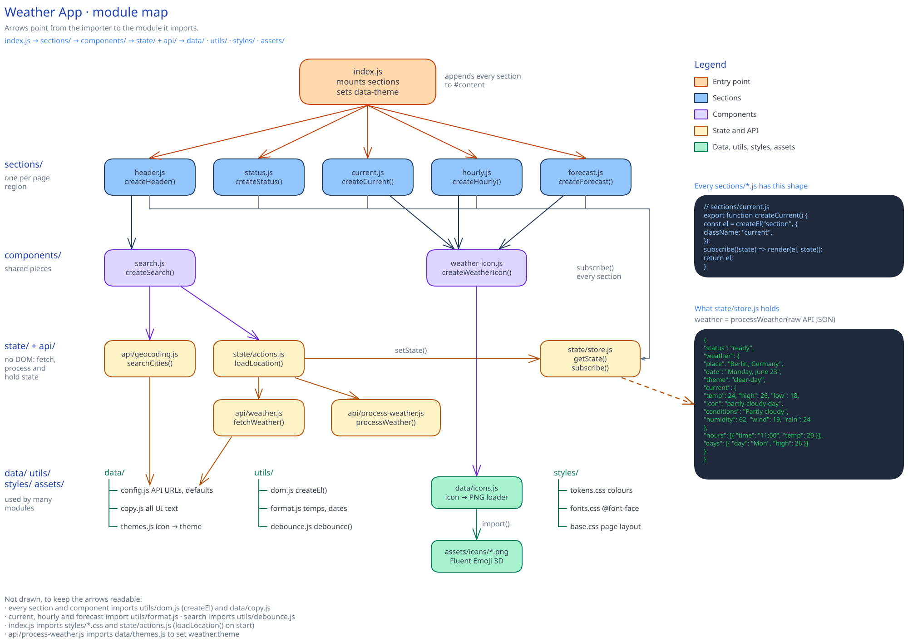
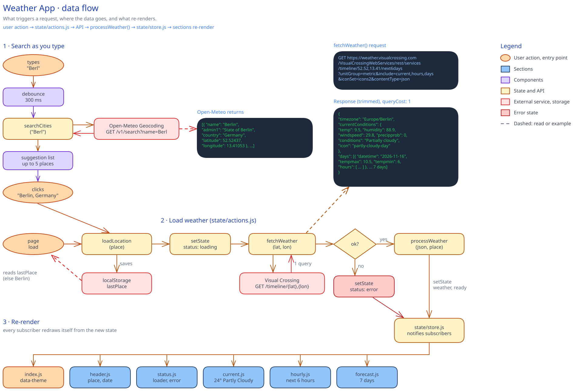

# Weather App: project plan

## Overview

A weather forecast site built from `project_brief.md` and the design in `design_files/UI_screens.png`.

The user searches for a city and sees:

- the location name and local date
- current conditions: icon, temperature, condition text, today's high and low, humidity, wind and chance of rain
- an hourly strip around the current hour, with "Now" highlighted
- a 7-day forecast in a bottom sheet that expands to show all seven days (the second screen in the design)

Temperatures are always in °C and wind in km/h. The look of the page changes with the current weather. Data comes from the Visual Crossing Weather API. City suggestions come from the Open-Meteo Geocoding API. The site is plain JavaScript bundled with Webpack and hosted as a static `dist/` on GitHub Pages.

## Decisions

### Scope

- **Mobile layout only.** One mobile-width column (max about 430px). On wider screens the column is centred and the rest of the page is one flat background colour. The three CLAUDE.md breakpoints collapse to this rule. The brief overrides them.
- **Units: °C and km/h only.** Agreed with the client on 2026-11-16. This replaces the brief's °C/°F toggle, so there is no toggle control and no unit setting in state.
- **Header actions.** The bell and hamburger buttons in the design are replaced by one search button.
- **Search.** The search button opens a search bar. While the user types (from 2 characters, debounced about 300 ms), city suggestions appear below it. Clicking a suggestion closes the search bar and loads that city's weather straight away, with no submit step. Pressing Enter picks the first suggestion. Escape closes the bar.
- **No page dots.** The three dots under the 7-day list in the design are dropped.
- **7-day sheet.** Collapsed, the sheet shows the first two days, as in screen 1. Tapping the handle or the title expands it to all seven days, as in screen 2. Tapping again collapses it. Drag gestures are out of scope.
- **Weather-dependent look.** The current conditions' `icon` value maps to a theme group: clear-day, clear-night, cloudy, rain, thunder, snow or fog. The app sets `data-theme` on its root element. Each theme only swaps colour tokens in `src/styles/tokens.css`, such as the header card gradient, the accent and the page background. The design's blue is the clear-day / partly-cloudy theme. Decided in T-19: the other six palettes are derived from that blue (night indigo, cloudy and fog greys, rain steel blue, thunder violet, snow icy blue), and every text colour is at least 4.5:1 in every theme. To reach that, the hourly slots are a deeper blue than the design's (`#2f74cb` for `#548ed7`), and the light "Now" slot uses the card's navy text instead of white.
- **Loading state.** A loading indicator shows from the moment a city is chosen until the data arrives. This is optional in the brief and included here.
- **Error state.** "City not found" and "network error" messages show in place of the content, with the last good data kept if there is any. The design has no screen for this (see Open questions).
- **Where status messages show.** Decided in T-18. With no weather on screen yet, the loader or error sits in the content area under the header. With weather on screen, it floats at the bottom of the column, so the page doesn't shift and the shown weather stays. A floating error has a close button, because it stays until the next load.
- **Start-up location.** The last city the user picked is remembered in `localStorage`. On a first visit the app loads Berlin, Germany, as in the design.
- **Hourly strip.** Six slots: the previous hour, "Now", then the next four hours, as in the design. Data comes from today's and tomorrow's `hours` arrays, in the location's own timezone. Between 00:00 and 00:59 there is no previous hour in the response, so the strip starts at "Now".
- **7-day list.** It starts with today, matching the design, where "Mon" is the current day. Each row shows the day's high (`tempmax`), icon and condition text.
- **Condition text.** Decided in T-05. The UI shows a short, title-case label chosen by the `icons2` value (`CONDITION_LABELS` in `src/data/copy.js`), such as "Partly Cloudy" or "Showers". It does not show the API's `conditions` text, which reads like "Rain, Partially cloudy" and doesn't match the design. The design's "Mostly Sunny", "Light Rain" and "Rain Likely" have no matching `icons2` value, so those days show the nearest label.

### APIs (no keys, called directly from the browser)

| Use              | Endpoint                                                                                                                                                                                | Notes                                                                                                                                                                                                                                                                                                                                                         |
| ---------------- | --------------------------------------------------------------------------------------------------------------------------------------------------------------------------------------- | ------------------------------------------------------------------------------------------------------------------------------------------------------------------------------------------------------------------------------------------------------------------------------------------------------------------------------------------------------------- |
| Weather          | `https://weather.visualcrossing.com/VisualCrossingWebServices/rest/services/timeline/{lat},{lon}/next6days?unitGroup=metric&include=current,hours,days&iconSet=icons2&contentType=json` | Tested 2026-11-16. Works without a key. Anonymous requests must accept gzip, which browsers do automatically. CORS is open. `/next6days` returns exactly 7 days (today plus 6), with hours for today and tomorrow. Each request costs 1 query (`queryCost: 1`), so the free limit of 1000 a day allows about 1000 city loads. No response caching is planned. |
| City suggestions | `https://geocoding-api.open-meteo.com/v1/search?name={query}&count=5&language=en&format=json`                                                                                           | Tested 2026-11-16. Returns `name`, `admin1`, `country`, `latitude`, `longitude` and `timezone`. Weather is fetched by coordinates so that a city name can't resolve to the wrong place.                                                                                                                                                                       |

Fields the app uses from the weather response:

- `currentConditions`: `temp`, `conditions`, `icon`, `humidity`, `windspeed` and `precipprob` (the "Rain" value)
- `days[]`: `datetime`, `tempmax`, `tempmin`, `conditions`, `icon` and `hours[]`
- top level: `timezone`

The response is reduced to one small app object by a processing function. The raw JSON is never passed to the UI.

### Assets and their sources

- **Weather icons:** [Microsoft Fluent Emoji](https://github.com/microsoft/fluentui-emoji), 3D PNG variant, MIT licence. Only the icons we use are copied into `src/assets/icons/` with the licence text. A table in `src/data/` maps each Visual Crossing `icons2` value to a file. Icons load through dynamic `import()` so Webpack bundles only these files.

  | `icons2` value                                                 | Fluent icon                   |
  | -------------------------------------------------------------- | ----------------------------- |
  | `clear-day`                                                    | Sun                           |
  | `clear-night`                                                  | Crescent moon                 |
  | `partly-cloudy-day`                                            | Sun behind small cloud        |
  | `partly-cloudy-night`                                          | Cloud                         |
  | `cloudy`                                                       | Cloud                         |
  | `showers-day`                                                  | Sun behind rain cloud         |
  | `showers-night`, `rain`                                        | Cloud with rain               |
  | `thunder-rain`, `thunder-showers-day`, `thunder-showers-night` | Cloud with lightning and rain |
  | `snow`, `snow-showers-day`, `snow-showers-night`               | Cloud with snow               |
  | `fog`                                                          | Fog                           |
  | `wind`                                                         | Wind face                     |

- **Interface icons:** search, close and the high/low arrows are small SVGs drawn for this project, kept in `src/assets/ui/`. Decided in T-12: CSS uses them as masks (`mask-image`) painted with `currentColor`, so their colour comes from the tokens and `createEl` never has to build SVG elements.
- **Font:** the design's typeface is not named. **Archivo** (variable, SIL OFL 1.1) was chosen in T-03 as the closest free match after comparing eight Google Fonts against the design. It is set wide: `font-stretch` 112% for text and 125% for the large temperature. It is self-hosted from `@fontsource-variable/archivo@5.3.0` (Latin and Latin Extended files) in `src/assets/fonts/`, with the licence in `OFL.txt`.

### Attribution

A small footer line under the 7-day list credits:

- "Weather data by Visual Crossing", linked. Visual Crossing asks for a visible, linked credit near the data.
- "Places by Open-Meteo / GeoNames", linked. The data is CC BY 4.0.
- The Fluent Emoji MIT notice, kept in `src/assets/icons/LICENSE`.

### Hosting

Static `dist/` on GitHub Pages under `/weather_app/`. There are no secrets or environment variables, so no deploy diagram is needed.

### Project layout additions

Two folders are added to the CLAUDE.md layout for the non-visual code:

- `src/api/`: the request functions and the JSON processing
- `src/state/`: the app state and change notifications

## Architecture

Approved by the client on 2026-11-16. The editable sources are the `.excalidraw` files beside each SVG.





### Folder tree

```
src/
  index.js               imports global CSS, mounts every section into #content,
                         sets data-theme from state, calls loadLocation() on start
  template.html          <head> plus an empty <div id="content">
  api/
    weather.js           fetchWeather(lat, lon): raw Visual Crossing JSON
    process-weather.js   processWeather(json, place): the app's weather object
    geocoding.js         searchCities(query): list of places
  state/
    store.js             getState(), setState(patch), subscribe(fn)
    actions.js           loadLocation(place)
  data/
    config.js            locale and unit symbols (T-04), API base URLs and
                         query params, default place, debounce delay,
                         localStorage key (T-05)
    copy.js              all UI text, including attribution
    themes.js            icons2 value → theme group
    icons.js             icons2 value → () => import("../assets/icons/<file>.png")
  utils/
    dom.js               createEl()
    format.js            formatTemp(), formatWind(), formatPercent(),
                         formatDate(), formatHour(), formatDay()
    debounce.js          debounce(fn, ms)
  components/
    search.js / .css     createSearch()
    weather-icon.js / .css  createWeatherIcon(icon, options)
  sections/
    header.js / .css     createHeader()
    status.js / .css     createStatus()
    current.js / .css    createCurrent()
    hourly.js / .css     createHourly()
    forecast.js / .css   createForecast()
  styles/
    tokens.css           colours (per theme), spacing, radii, type scale
    fonts.css            @font-face for the self-hosted font
    base.css             reset, page background, centred mobile column
  assets/
    icons/               Fluent Emoji 3D PNGs + LICENSE
    ui/                  interface icon SVGs, used as CSS masks
    fonts/               .woff2 files
docs/
  diagrams/              module-map and data-flow (.excalidraw + .svg)
```

### Module pattern

- **Sections** export `createX()`, which builds the section's element once with `createEl`, subscribes to the store and re-renders its own contents on each change. `index.js` appends each one to `#content`. Sections never fetch.
- **Components** export `createX(props)` and return an element. They don't subscribe to the store. The exception is `createSearch()`, which calls `searchCities()` and `loadLocation()` itself.
- **API modules** are plain async functions with no DOM access. `fetchWeather()` and `searchCities()` throw on a failed response, and `processWeather()` is a pure function.
- **`state/actions.js`** is the only module that calls `fetchWeather()` and writes weather into the store. If a newer `loadLocation()` starts before an older one finishes, only the newest result is applied.
- **`state/store.js`** is a small publish/subscribe object. Its state shape:

  ```js
  {
    status: "idle" | "loading" | "ready" | "error",
    error: null | "not-found" | "network",
    place: { name: "Berlin", country: "Germany", latitude: 52.52, longitude: 13.41 },
    weather: null | {
      place: "Berlin, Germany",
      date: "Monday, June 23",
      theme: "clear-day",
      current: { temp: 24, high: 26, low: 18, icon: "partly-cloudy-day",
                 conditions: "Partly Cloudy", humidity: 62, wind: 19, rain: 24 },
      hours: [{ time: "11:00", temp: 20, icon: "cloudy", isNow: false }, …],   // 6
      days:  [{ day: "Mon", high: 26, icon: "partly-cloudy-day", conditions: "Partly Cloudy" }, …], // 7
    },
  }
  ```

## Tasks

Every task also carries the implicit Definition of Done from CLAUDE.md: `npm run check` passes with no errors or warnings, and the task's files are formatted.

### Phase 0: Setup

| ID   | Task                     | Priority | Definition of Done                                                                                                                                                                      |
| ---- | ------------------------ | -------- | --------------------------------------------------------------------------------------------------------------------------------------------------------------------------------------- |
| T-01 | Project setup            | Must     | `npm run dev` serves the page · lint and format check pass · `node_modules` and `dist` are git-ignored · build has no errors or warnings                                                |
| T-02 | Project plan (`plan.md`) | Must     | Overview, Decisions and Open questions written · Excalidraw registered in `.mcp.json` · diagrams saved and approved · Architecture, Tasks and Verification written · tasks on the board |

### Phase 1: Foundation

| ID   | Task                                                      | Priority | Definition of Done                                                                                                                                                                                                                                                        |
| ---- | --------------------------------------------------------- | -------- | ------------------------------------------------------------------------------------------------------------------------------------------------------------------------------------------------------------------------------------------------------------------------- |
| T-03 | Styles and page shell (`styles/`, `index.js` CSS imports) | Must     | Tokens hold the design's colours, radii, spacing and type scale · font is self-hosted, with no request to an external host · on desktop the column is centred with one flat colour around it · no horizontal scroll from 320px to 430px · no colours outside `tokens.css` |
| T-04 | Shared utils (`utils/dom.js`, `format.js`, `debounce.js`) | Must     | `createEl` matches CLAUDE.md · `formatTemp(24)` → "24°", `formatWind(19)` → "19 km/h", `formatPercent(62)` → "62%" · `formatDate`, `formatHour` and `formatDay` use the location's timezone, not the device's · `debounce` fires once after the pause                     |
| T-05 | Data modules (`data/config.js`, `copy.js`, `themes.js`)   | Must     | Design copy is verbatim in `copy.js`, plus the new strings (search placeholder, errors, attribution) · every `icons2` value maps to a theme group · API URLs and default place live only in `config.js`                                                                   |
| T-06 | Weather icon assets (`data/icons.js`, `assets/icons/`)    | Must     | the 10 Fluent Emoji 3D PNGs from the mapping table and the MIT LICENSE copied in · all 16 `icons2` values map to a loader · production build emits only these PNGs                                                                                                        |
| T-07 | Weather API (`api/weather.js`)                            | Must     | `fetchWeather(52.52, 13.41)` logs the raw JSON in the console (brief step) · URL built from `config.js` · rejects with a clear error on a non-OK response or network failure                                                                                              |
| T-08 | Process weather (`api/process-weather.js`)                | Must     | Returns the documented `weather` shape for a real response and logs it (brief step) · 6 hours with `isNow` on the current hour, crossing midnight correctly · 7 days starting today · numbers rounded · theme from `themes.js`                                            |
| T-09 | Geocoding API (`api/geocoding.js`)                        | Must     | `searchCities("Berl")` returns Berlin, Germany first, with a "Berlin, Germany" label · fewer than 2 characters or no match returns `[]` · rejects on network failure                                                                                                      |
| T-10 | State store (`state/store.js`)                            | Must     | `setState` merges and notifies every subscriber · `subscribe` returns an unsubscribe function that works · initial state matches the documented shape                                                                                                                     |
| T-11 | Actions and start-up (`state/actions.js`, `index.js`)     | Must     | Page load logs a `ready` state with Berlin weather (brief step) · status goes loading → ready, or loading → error with the previous weather kept · last place saved and restored after reload · only the newest of two overlapping loads is applied                       |

### Phase 2: Features

| ID   | Task                                                          | Priority | Definition of Done                                                                                                                                                                                                                                                            |
| ---- | ------------------------------------------------------------- | -------- | ----------------------------------------------------------------------------------------------------------------------------------------------------------------------------------------------------------------------------------------------------------------------------- |
| T-12 | Header section (`sections/header`)                            | Must     | Matches the design header with the bell and hamburger replaced by one search button · place and local date come from state · the search button has an accessible name                                                                                                         |
| T-13 | Search component (`components/search`)                        | Must     | Header button opens the search bar · typing "Berl" shows suggestions, with one request per pause in typing (Network tab) · clicking a suggestion loads it and closes the bar · Enter picks the first suggestion, Escape closes and returns focus · "no results" message shows |
| T-14 | Weather icon component (`components/weather-icon`)            | Must     | All 16 `icons2` values render the mapped PNG · an unknown value falls back to Cloud · space is reserved, so nothing jumps while the PNG loads · decorative icons are hidden from screen readers                                                                               |
| T-15 | Current conditions section (`sections/current`)               | Must     | Matches the design's top card: icon, temperature, condition, High and Low pills, and the Humidity / Wind / Rain panel · values in °C, km/h and % from state · copy is verbatim                                                                                                |
| T-16 | Hourly strip (`sections/hourly`)                              | Must     | Six slots: previous hour, "Now" and the next four, in the location's time · the "Now" slot is styled as in the design · correct after 20:00, when the strip crosses midnight                                                                                                  |
| T-17 | 7-day forecast sheet (`sections/forecast`)                    | Must     | Matches both design screens · collapsed shows 2 rows, expanded shows 7 starting today · the handle or title is a button with `aria-expanded` · no page dots · attribution links shown under the list                                                                          |
| T-18 | Status section (`sections/status`)                            | Should   | Loader shows from city pick until data arrives (checked with DevTools Slow 3G) · "not found" and "network" errors show their messages · status changes are announced through `aria-live`                                                                                      |
| T-19 | Weather themes (`index.js` data-theme, `tokens.css` palettes) | Must     | `data-theme` follows the current conditions · palettes for clear-day, clear-night, cloudy, rain, thunder, snow and fog · text contrast at least 4.5:1 in every theme · colours only in `tokens.css`                                                                           |

### Phase 3: Finish

| ID   | Task                                                      | Priority | Definition of Done                                                                                                                                        |
| ---- | --------------------------------------------------------- | -------- | --------------------------------------------------------------------------------------------------------------------------------------------------------- |
| T-20 | Accessibility and polish                                  | Should   | Visible focus styles · the whole flow works by keyboard alone · `prefers-reduced-motion` respected · Lighthouse mobile Accessibility at least 95          |
| T-21 | Cross-device and network check                            | Should   | The whole-project checks under Verification pass in Chrome, Safari and Firefox · widths 320, 375, 390 and 430px · Slow 3G and offline behave as described |
| T-23 | Production build without eval source maps (found in T-03) | Should   | `npm run build` output contains no `eval(` and no inline source maps · `npm run dev` keeps fast source maps · done before T-22                            |
| T-22 | README and GitHub Pages deploy                            | Must     | README covers what the app is, how to run it, and credits · asset paths work under `/weather_app/` · the live URL loads Berlin and a searched city        |

## Open questions

Build as described in Decisions until the client answers.

1. **Theme colours per weather.** The design shows only one theme. The other palettes (night, cloudy, rain, thunder, snow, fog) will be derived from the design's blue. Confirm, or supply colours.
2. **Font.** Which typeface does the design use? Default: Archivo, set wide (see Assets).
3. **Error and empty states.** The design has no screens for "city not found", "network error" or "no suggestions". Default: a short message in the content area, styled like the forecast rows.
4. **"Rain" value.** It shows the chance of rain (`precipprob`), not an amount. Confirm.
5. **7-day temperature.** Each forecast row shows one temperature. Default: the day's high.

## Verification

### Every task

1. Run `npm run format`, then `npm run check`. Lint, the format check and the production build must finish with no errors or warnings. Lint also blocks `innerHTML`.
2. Check each Definition of Done item and tick only what was actually verified. The task report says which items still need the user's eyes in a browser.
3. If the task changed how modules connect, the affected diagram is updated, re-exported and part of the same commit.

### By task type

- **API, state and data (T-04 to T-11).** Run `npm run dev` and check the console output and the Network tab: request URLs, response status, and the logged objects against the documented shapes. Test error paths with DevTools set to offline, and by searching for a nonsense name.
- **Sections and components (T-12 to T-19).** In DevTools device mode at 390px wide, compare the page with `design_files/UI_screens.png`. Copy must match the design word for word. There are no inline styles, and every colour comes from `tokens.css`.
- **Look and feel.** Visual match, motion and theme colours are confirmed by the user in a browser before a task moves to Done.

### Whole project (T-21, then again on the live URL in T-22)

1. Fresh visit (clear `localStorage`): the loader shows, then Berlin, Germany loads.
2. Search "Lond", pick "London, United Kingdom": the weather loads, the header updates and the search bar closes.
3. Reload: London is restored.
4. Search "xqzv": the "no results" message shows.
5. DevTools offline, then pick a city: the network error shows and the previous weather stays.
6. DevTools Slow 3G: the loader stays visible until the data arrives.
7. Expand and collapse the 7-day sheet: 7 rows, starting today.
8. Pick Tokyo: the date, the hourly times and "Now" follow Tokyo time, not the device's.
9. Widths 320 to 430px show no horizontal scroll. On desktop the column is centred on one flat colour.
10. Keyboard only: open search, pick a suggestion, expand the sheet.
11. Lighthouse mobile: Accessibility at least 95, Best Practices at least 90.
12. Attribution links are visible and work.
